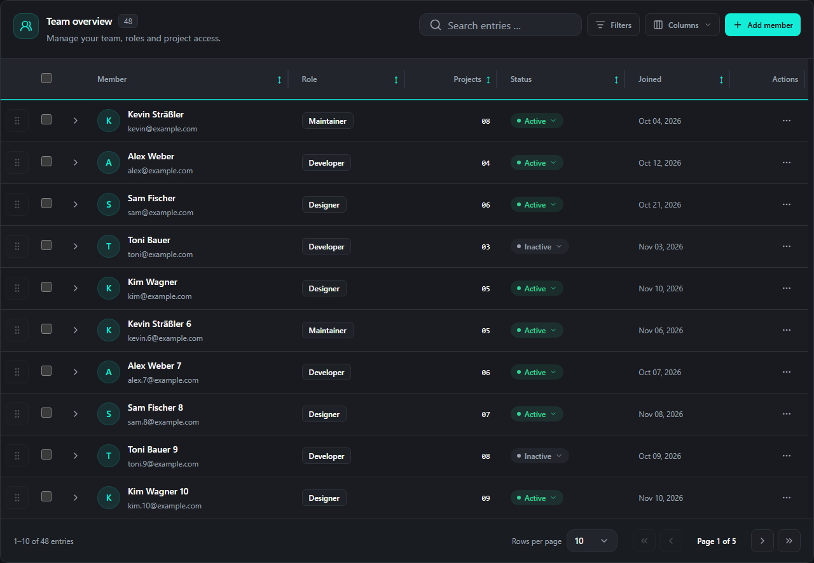
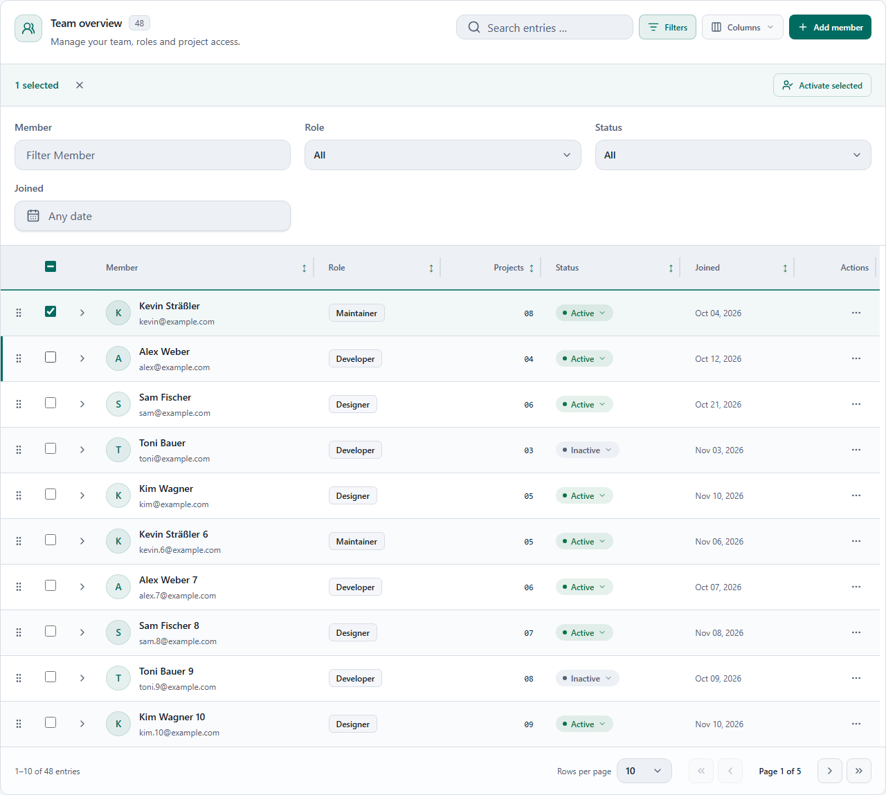
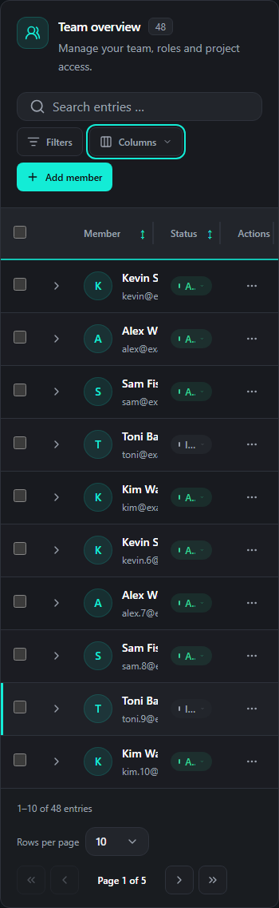

<p align="center">
    
</p>

<p align="center">
    <a href="https://github.com/RentnerKev/RentnerTable/actions/workflows/ci.yml"></a>
    <a href="https://github.com/RentnerKev/RentnerTable/actions/workflows/codeql.yml"></a>
    <a href="https://www.npmjs.com/package/@rentnerkev/table"></a>
    <a href="https://www.npmjs.com/package/@rentnerkev/table"></a>
    <a href="https://react.dev"></a>
    <a href="https://tailwindcss.com"></a>
    <a href="./LICENSE"></a>
</p>

Accessible, typed React tables built with TanStack Table 9 and shared RentnerKev styling. Define your columns once and reuse search, filters, selection, pagination and actions across your projects.

## Installation

Requires React 19, React DOM 19, and Tailwind CSS 4. Components use the existing RentnerKev input, select, menu and calendar packages.

```bash
npm install @rentnerkev/table
# or with Bun
bun add @rentnerkev/table
```

The package contains compiled ESM, declarations, styles and usage documentation.

Import the package styles after Tailwind in your app stylesheet:

```css
@import 'tailwindcss';
@import '@rentnerkev/table/tailwind.css';
```

The stylesheet includes the styles of the controls used by the table.

## Quick start

```tsx
'use client'

import { DataTable, createTableColumnHelper } from '@rentnerkev/table'

type Member = {
    id: string
    name: string
    role: string
    joined: string
}

const column = createTableColumnHelper<Member>()
const columns = column.columns([
    column.accessor('name', {
        header: 'Member',
        meta: { filter: { type: 'text' } },
    }),
    column.accessor('role', {
        header: 'Role',
        meta: {
            filter: {
                type: 'select',
                options: [
                    { value: 'Developer', label: 'Developer' },
                    { value: 'Designer', label: 'Designer' },
                ],
            },
        },
    }),
    column.accessor('joined', {
        header: 'Joined',
        meta: { filter: { type: 'dateRange' } },
    }),
])

export function TeamTable({ members }: { members: readonly Member[] }) {
    return (
        <DataTable
            data={members}
            columns={columns}
            getRowId={(member) => member.id}
            getRowLabel={(member) => member.name}
            title="Team overview"
            description="Manage your team and roles."
            locale="en"
            selectable
        />
    )
}
```

Keep column definitions and input data stable between unrelated renders. Use real record IDs for selection and expanded details.

## Screenshots

| Dark theme                                                                                                                                                                                                                             | Light theme, filters and selection                                                                                                                                                                                                                                   |
| -------------------------------------------------------------------------------------------------------------------------------------------------------------------------------------------------------------------------------------- | -------------------------------------------------------------------------------------------------------------------------------------------------------------------------------------------------------------------------------------------------------------------- |
| [](https://raw.githubusercontent.com/RentnerKev/RentnerTable/main/assets/readme/screenshots/dark-table.png) | [](https://raw.githubusercontent.com/RentnerKev/RentnerTable/main/assets/readme/screenshots/light-table.png) |

Screenshots come from the local playground with example data.

<details>
<summary>Mobile layout</summary>

<p align="center">
    
</p>

</details>

[Full API & usage](./docs/usage.md) · [Local playground](./playground) · [Repository automation](./.github/AUTOMATION.md) · [MIT license](./LICENSE)

## Features

- Typed accessor, display and grouped columns through `createTableColumnHelper`.
- Global search and spacious, responsive text/select/date-range filters with custom renderers.
- Keyboard sorting, Shift multi-sort, column visibility and configurable page sizes.
- Stable row selection across pages, selectable-row predicates and bulk actions.
- Row action menus, expandable details and custom cell renderers.
- Optional column resizing bounded by the available viewport, with mouse, touch and keyboard controls.
- Optional row reordering with bounded previews, keyboard support and controlled data callbacks.
- Typed row/cell click, double-click and context-menu callbacks for application actions.
- Loading, refreshing, error/retry, empty and no-results states with readable search/filter context.
- Optional versioned preferences in local/session storage or an asynchronous database adapter, including internal row order.
- German and English messages with per-message overrides.
- Shared `--rentner-*` theme tokens, scoped popup containers, three densities and striped rows.
- Native table semantics, SSR, headless composition and controlled server pagination/filtering/sorting.
- Paginated rendering and query preparation before row filtering. Calendar controls load on demand.

`Table` provides the minimal sortable table without a toolbar or pagination. `DataTable` adds the reusable management interface; `useDataTableLogic` and `TableSurface` support custom composition.

## Development

Requires Bun 1.4.4 with native `bun fmt` support.

```bash
bun install --frozen-lockfile
bun run playground:install
bun run playground:dev
```

Open **http://127.0.0.1:4179**. Try resizing, row reordering, status editing, context menus, filters, bulk actions, row details, themes and loading/error/empty states. Enable **Remember settings** and reload to restore the table's preferences and internal row order.

```bash
bunx playwright install chromium firefox webkit
bun run verify
```

Verification includes typechecks, lint, formatting, tests, package build, an isolated installed consumer, production playground build, and Chromium/Firefox/WebKit tests with accessibility scans. CI also checks React 19.0.0 and 19.3.1.

Library components, hooks and types live under `src/shared/Table`, UI-free helpers under `src/lib`, and tests mirror these owners in `src/tests`. Playground source and marketing images stay outside the published package.

## Releases and maintenance

Dependabot checks both Bun packages and GitHub Actions daily. Verified minor/patch updates receive automatic approval and guarded squash auto-merge after the protected branch's checks pass. Major updates require maintainer review.

Publishing a stable GitHub release named `vMAJOR.MINOR.PATCH` triggers exact-tag verification, tag-derived package versioning and npm publication with provenance. A separate workflow generates release notes and uploads the project banner. Pushing commits or tags alone does not publish a package.

The npm Trusted Publisher authorizes GitHub owner `RentnerKev`, repository `RentnerTable` and workflow filename `npm-publish.yml`. Future releases use OIDC rather than a stored npm token. See [automation setup](./.github/AUTOMATION.md) for the repository settings, update policy and release procedure.

## License

MIT © RentnerKev
